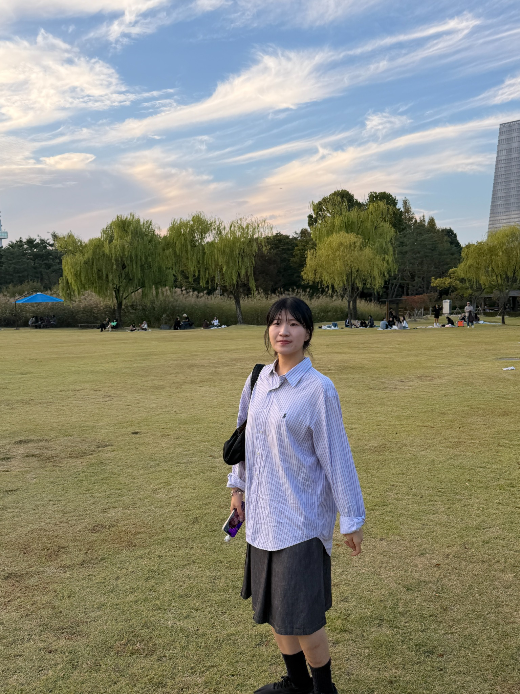

<main class="profile-page">

  <header class="hero">
    

    

      <h1>Chaehee Park</h1>
      
AI Researcher

      

        Researcher, 3rd Technology Research Institute · Seoul Research Division 
        <a href="https://www.add.re.kr/">Agency for Defense Development (ADD)</a> · Seoul, Republic of Korea
      

      

        I am an AI researcher working on large language models, multimodal AI,
        retrieval-augmented generation, and trustworthy AI systems. My background
        spans both research and applied public-sector projects, with experience in
        policy AI, digital-safety systems, urban analytics, and human-centered AI.
      

      
Last updated: November 8, 2026

    

  </header>

  <section>
    <h2>Research Interests</h2>
    <ul class="clean-list">
      <li>Large Language Models, Retrieval-Augmented Generation, and Agentic AI</li>
      <li>Multimodal AI and Human–AI Interaction</li>
      <li>Trustworthy AI, Evaluation, Governance, and Responsible Deployment</li>
      <li>AI for Public-Sector and Mission-Oriented Systems</li>
    </ul>
  </section>

  <section>
    <h2>Professional Experience</h2>

    <article class="timeline-item">
      

        <a href="https://www.add.re.kr/">Agency for Defense Development (ADD)</a>
        Oct. 2026 – Present
      

      
Researcher, 3rd Technology Research Institute · Seoul Research Division

      <ul>
        <li>Conduct research as a member of the 3rd Technology Research Institute at ADD.</li>
        <li>Focus on AI systems including large language models, multimodal AI, and trustworthy deployment.</li>
      </ul>
    </article>

    <article class="timeline-item">
      

        <a href="https://www.si.re.kr/index.do">The Seoul Institute</a>
        Apr. 2025 – Sep. 2026
      

      
Researcher, AI &amp; Big Data Team · Seoul, Republic of Korea

      <ul>
        <li>Worked on AI transformation, public-sector AI strategy, and institutional adoption of LLM, RAG, and agent-based systems.</li>
        <li>Contributed to digital-crime prevention, AI-enabled public safety, urban analytics, and international smart-city collaboration projects.</li>
        <li>Co-authored official reports on AI-assisted policy research, Seoul-specific AI services, and AI capability standards for public officials.</li>
      </ul>
    </article>

    <article class="timeline-item">
      

        NCSOFT
        Jun. 2022 – Sep. 2022
      

      
Research Assistant, Language AI Team · Seongnam, Republic of Korea

      <ul>
        <li>Conducted research on aspect-based sentiment analysis and curated task-specific datasets.</li>
        <li>Developed resources for named entity recognition, sentiment analysis, and QA datasets.</li>
      </ul>
    </article>
  </section>

  <section>
    <h2>Selected Public-Sector AI Reports</h2>

    <article class="report-item">
      
Enhancing the Use of Policy Research through AI Technologies

      
AI 기술 기반 정책연구 활용도 증진방안

      
Proposed a RAG-based framework for converting institutional research assets into traceable, evidence-grounded support for policy research.

      
<a href="https://www.si.re.kr/bbs/view.do?key=2024100039&amp;pstSn=2601260008">Official Report</a>

    </article>

    <article class="report-item">
      
Strategies for Activating Seoul-Specific AI Administrative Services

      
서울시 맞춤형 AI 행정서비스 활성화 방안

      
Analyzed institutional, infrastructural, and regulatory requirements for Seoul-tailored AI administrative services and proposed a phased roadmap.

      
<a href="https://www.si.re.kr/bbs/view.do?key=2024100039&amp;pstSn=2611030001">Official Report</a>

    </article>

    <article class="report-item">
      
A Staged Competency Standard and Self-Assessment Framework for Strengthening Seoul Public Officials’ AI Capabilities

      
서울시 공무원의 AI 활용 역량 강화를 위한 단계별 기준 정립과 자가 진단 체계 연구

      
Designed a staged AI competency framework and self-assessment structure for public officials.

      
<a href="https://www.si.re.kr/bbs/view.do?key=2024100039&amp;pstSn=2610020003">Official Report</a>

    </article>
  </section>

  <section>
    <h2>Selected Projects</h2>

    

      

        <h3>Public-Sector AI Transformation</h3>
        <ul class="clean-list">
          <li>AI Governance and Public-Sector AI Ethics and Norms</li>
          <li>Research-Innovation sLLM-Based AI Transformation Framework and Roadmap</li>
          <li>AI Agent Framework for Administrative Support at The Seoul Institute</li>
        </ul>

        <h3>Urban Analytics and International Collaboration</h3>
        <ul class="clean-list">
          <li>Deep Learning-Based Personalized Leisure Walking Routes for Improved Park Accessibility</li>
          <li>Urban Safety Data Platform and CPTED Technical Assistance for Niterói, Brazil</li>
        </ul>
      

      

        <h3>AI for Public Safety and Digital Crime Prevention</h3>
        <ul class="clean-list">
          <li>Generative AI-Based Automated Analysis of EMS Activity Reports</li>
          <li>Proactive Response Strategies for Deepfake-Enabled Digital Sexual Crimes in Seoul</li>
          <li>Watcher Bot for Prevention of Online Prostitution and Sexual Exploitation Crimes</li>
          <li>AI-Based Online Grooming Detection and Smart Protection Alert System</li>
          <li>Information System for Seoul’s Online Sexual Exploitation “Safe ON” Center</li>
        </ul>
      

    

    

      Public links are included only where an official report, service page, or project material is publicly available.
    

  </section>

  <section>
    <h2>Education</h2>

    <article class="timeline-item">
      

        Sungkyunkwan University
        Mar. 2023 – Feb. 2025
      

      
M.S. in Applied Artificial Intelligence · Seoul, Republic of Korea

      <ul>
        <li>Advisor: Jinyoung Han</li>
        <li>Thesis: <strong>Developing a Draw-A-Person-in-the-Rain Assessment System Using a Multimodal Large Language Model</strong> — <a href="http://www.dcollection.net/handler/skku/000000181571">Thesis</a></li>
      </ul>
    </article>

    <article class="timeline-item">
      

        Sangmyung University
        Mar. 2019 – Feb. 2023
      

      
B.S. in Human-Centered Artificial Intelligence · Double Major in Applied Artificial Intelligence

    </article>
  </section>

  <section>
    <h2>Publications</h2>

    <h3>Journal Articles</h3>

    <article class="publication">
      
Machine Learning-Based Depression Screening Model from Pre-Drawn Structured Mandala Colorings

      
Se-Ryun Park†, Jonghan Kim†, Ujin Jeon, <strong>Chaehee Park</strong>, Sang-Shin Lee, Jinyoung Han*, and Yu-Jung Cha*

      
<em>Current Psychology</em>, 2026.

      
<a href="https://link.springer.com/article/10.1007/s12144-026-09822-y">Paper</a> <a href="https://doi.org/10.1007/s12144-026-09822-y">DOI</a>

    </article>

    <article class="publication">
      
Developing an AI-Based Explainable Expert Support System for Art Therapy

      
Jiwon Kang†, Jiwon Kim†, Migyeong Yang†, <strong>Chaehee Park†</strong>, Taeeun Kim, Hayeon Song, and Jinyoung Han*

      
<em>ACM Transactions on Interactive Intelligent Systems</em>, 14(4), 1–23, 2025.

      
<a href="https://dl.acm.org/doi/10.1145/3689649">Paper</a> <a href="https://doi.org/10.1145/3689649">DOI</a>

    </article>

    <h3>International Conference Papers</h3>

    <article class="publication">
      
BetaDAPR: An AI-Based Expert Support System for Art Therapists with Qualitative and Quantitative Assistance

      
Migyeong Yang, <strong>Chaehee Park</strong>, Hyunseon Won, Taeeun Kim, Hayeon Song, and Jinyoung Han*

      
<em>Proceedings of the ACM on Human-Computer Interaction (CSCW)</em>, 2026.

      
<a href="https://dl.acm.org/doi/10.1145/3816903">Paper</a> <a href="https://doi.org/10.1145/3816903">DOI</a>

    </article>

    <article class="publication">
      
CheckDAPR: An MLLM-Based Sketch Analysis System for Draw-A-Person-in-the-Rain Assessments

      
<strong>Chaehee Park†</strong>, Migyeong Yang†, Taeeun Kim, Hayeon Song, and Jinyoung Han*

      
<em>ACM International Conference on Information and Knowledge Management (CIKM)</em>, 2025.

      
<a href="https://dl.acm.org/doi/10.1145/3746252.3761571">Paper</a> <a href="https://doi.org/10.1145/3746252.3761571">DOI</a> <a href="https://github.com/DSAIL-SKKU/CheckDAPR">Code</a>

    </article>

    <article class="publication">
      
PracticeDAPR: An AI-Based Education-Supported System for Art Therapy

      
Migyeong Yang, <strong>Chaehee Park</strong>, Jiwon Kang, Jiwon Kim, Taeeun Kim, Hayeon Song, and Jinyoung Han*

      
<em>Proceedings of the ACM on Human-Computer Interaction (CSCW)</em>, 2025.

      
<a href="https://dl.acm.org/doi/10.1145/3711112">Paper</a> <a href="https://doi.org/10.1145/3711112">DOI</a>

    </article>

    <article class="publication">
      
SceneDAPR: A Scene-Level Free-Hand Drawing Dataset for Web-Based Psychological Drawing Assessment

      
Jiwon Kang, Jiwon Kim, Migyeong Yang, <strong>Chaehee Park</strong>, Taeeun Kim, Hayeon Song, and Jinyoung Han*

      
<em>Proceedings of the ACM Web Conference (WWW)</em>, 2024.

      
<a href="https://dl.acm.org/doi/10.1145/3589334.3648150">Paper</a> <a href="https://doi.org/10.1145/3589334.3648150">DOI</a> <a href="https://github.com/DSAIL-SKKU/SceneDAPR">Code</a>

    </article>

    <h3>Domestic Conference Papers</h3>

    <article class="publication">
      
A Spatiotemporal Prediction Model for Vehicle-Related Crime Using Urban Public Safety Data

      
<strong>Chaehee Park</strong>, Junchul Kim*

      
<em>2026 Summer Conference of the Korean Institute of Broadcast and Media Engineers (KIBME)</em>, Jun. 20, 2026.

    </article>

    <article class="publication">
      
A Feasibility Study of an Automated Barrier-Free Park Assessment Framework Using Geospatial Information and Computer Vision

      
<strong>Chaehee Park</strong>, Jeongok Kim*

      
<em>2025 Annual Conference of the Korean Society of Civil Engineers (KSCE)</em>, Nov. 13, 2025.

    </article>

    <article class="publication">
      
A Study on an Ensemble Model for Predicting Prompts from Images Generated by Diffusion Models

      
<strong>Chaehee Park</strong>, Migyeong Yang, Jiwon Kim, et al.

      
<em>2023 Summer Conference of the Korean Institute of Broadcast and Media Engineers (KIBME)</em>, Jun. 2023.

    </article>

    <article class="publication">
      
On Deep Generative Models Explaining Rationales for Emotionally Supportive Conversations

      
Eunhye Jeong†, <strong>Chaehee Park†</strong>, Hyejin Hong, et al.

      
<em>2022 Fall Conference of the Korean Society for Emotion and Sensibility (KOSES)</em>, Oct. 2022.

    </article>

    
† Equal contribution. * Corresponding author.

  </section>

  <section>
    <h2>Academic Service</h2>
    <ul class="clean-list">
      <li><strong>Reviewer</strong>, <em>ACM CHI Conference on Human Factors in Computing Systems — Posters</em>, 2026</li>
      <li><strong>Reviewer</strong>, <em>Cognitive Processing</em>, 2026</li>
    </ul>
  </section>

  <section>
    <h2>Teaching Experience</h2>
    <ul class="clean-list">
      <li><strong>Sungkyunkwan University</strong>, Teaching Assistant, Summer 2023</li>
      <li><strong>Sangmyung University</strong>, Teaching Assistant, 2021–2022</li>
    </ul>
  </section>

</main>
